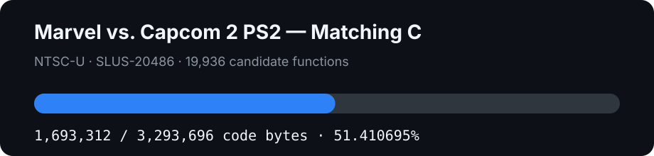

# Marvel vs. Capcom 2 PS2 decompilation

[](https://github.com/g-guthrie/mvc2-ps2-decomp/actions/workflows/report.yml)
[](https://decomp.dev/g-guthrie/mvc2-ps2-decomp)

[](DECOMP.md)

An early matching decompilation of **Marvel vs. Capcom 2: New Age of Heroes**
for PlayStation 2, targeting the NTSC-U executable `SLUS_204.86`.

This is a separate project from the Dreamcast decompilation. The PS2 port uses
the Emotion Engine's MIPS R5900 instruction set and identifies its original
compiler as `MW MIPS C Compiler (2.4.1.01)` / `PlayStation2`.

## Target

| Item | Value |
| --- | --- |
| Serial | `SLUS-20486` |
| ELF entry point | `0x00100008` |
| ELF SHA-1 | `dd8558a04891b0b1472ea1d8ae2bb84947ae8937` |
| ELF SHA-256 | `48ebf907d8149122ca9bd622ed11c290d5f93173078ea5bd570e1ac5566f13d7` |
| Loaded image | `0x00100000..0x004c2580` (`3,941,760` bytes) |
| Loaded-image SHA-1 | `a425c36425bbc1072114ea091ac4577c98c59a6a` |
| Conservative text | `0x00100000..0x00424200` (`3,293,696` bytes) |
| Initialized data | `0x00424200..0x004c2580` (`648,064` bytes) |
| BSS | `0x004c2580..0x00634380` (`0x171e00` bytes) |
| Global pointer | `0x004c7270` |

The generated graphic above shows the current catalog's matching code coverage.
[decomp.dev](https://decomp.dev/g-guthrie/mvc2-ps2-decomp) publishes current
function counts and reconstructed-data coverage. Whole-object compiler
verification and full-image linkage are separate private build checks.
Assembly placeholders never count as decompiled source. The initial inventory
contained 17,658 explicit-size function candidates. Splitting 2,077 oversized
dispatcher entries into exact C heads plus retained assembly residuals produces
a current denominator of **19,888 units**. No residual bytes were dropped; text
gaps and initialized data remain separately visible in the progress report.

Compiler-in-the-loop evidence currently identifies
`mwcps2-3.0.3-020716` as the strongest product-build candidate with an `-O3`
baseline. See [docs/COMPILER.md](docs/COMPILER.md); the exact getter matches do
not yet discriminate `-O3` from `-O4,p` or prove the retail small-data threshold.

## Setup

Use your own legally obtained NTSC-U PS2 disc dump. For a single-track
`MODE2/2352` BIN/CUE pair:

```sh
python3 -m venv .venv
.venv/bin/pip install -r requirements.txt
make setup BIN="/path/to/game.bin" CUE="/path/to/game.cue"
make split
```

`bchunk` and `7z` must be installed for `make setup`. All extracted game data,
generated assembly, and build output remain ignored.

## Cloud executors

Supply your own build-inputs bundle using the layout in
[build-inputs/README.md](build-inputs/README.md).
See [docs/CLOUD_BUILD.md](docs/CLOUD_BUILD.md) for Linux dependencies.
After creating `.venv` and installing `requirements.txt`, prepare the Mac EE GCC
runner or Linux dependencies described in [docs/CLOUD_BUILD.md](docs/CLOUD_BUILD.md):

```sh
.venv/bin/python tools/bootstrap_private_inputs.py --archive /path/to/mvc2-ps2-build-inputs.tar.gz
. private/build.env
"$PYTHON" tools/setup_sony29.py
. private/sony29.env
make split hybrid test report PYTHON="$PYTHON"
```

The bootstrap verifies the supplied retail image, both Metrowerks compilers, SN GCC 2.95.2, and EE GCC 2.96,
selects a host-compatible Wibo, smoke-tests compilation, and supplies the tool
paths. No private repository access or GitHub authentication is required.

## Exact hybrid relink baseline

The stripped retail image mixes instructions and initialized data inside one
RWX segment. Until every code/data boundary is represented semantically, the
baseline rawifies Splat's reviewed per-word payload comments before assembling.
This prevents GNU assembler pseudo-op expansion from changing retail bytes.

```sh
make split
make relink
```

`make relink` reconstructs all 3,941,760 loaded bytes, links BSS at
`0x004c2580`, and requires both SHA-1 and SHA-256 plus a byte-for-byte `cmp`.
`make hybrid` also deterministically reconstructs the full retail ELF
container—headers, program headers, section headers, `.comment`, `.reginfo`,
and padding—and requires it to match `SLUS_204.86` byte-for-byte.

## Matching-C verification

After placing private `wibo` and `mwcps2.exe` binaries outside Git:

```sh
WIBO=/private/path/wibo-macos \
MWCCPS2=/private/path/mwccps2.exe \
MWCCPS2_30=/private/path/mwcps2-3.0-011126/mwccps2.exe \
make match PYTHON=.venv/bin/python
```

The verifier applies MIPS HI16/LO16/26/32 relocations using the reviewed target
symbols before comparing every function directly with the retail loaded image.
Most units use MWCCPS2 3.0.3; the explicitly documented `state_return_family`
unit is compiled with 3.0-011126 because that compiler is the only tested one
that reproduces its target scheduling exactly.

`make hybrid` then replaces all matched retail windows with the actual compiled
Metrowerks function sections and requires exact symbol placement plus the full
loaded-image hashes and byte comparison.

## Progress reporting

```sh
make test
make report
```

The GitHub Actions workflow uploads a valid objdiff-v2 report as `ps2_report`,
which is the artifact consumed by decomp.dev.

## Runtime testing

The rebuilt ELF can eventually be inserted into a private disc image and tested
with PCSX2, AetherSX2, or real PS2 hardware. Emulator files are not part of this
repository.

## Legal

Executable and period compiler build inputs must be supplied locally. Disc
images, extracted game assets, generated retail assembly, and Sony SDK files
are excluded from the repository. This research project is not
affiliated with Capcom, Marvel, Sony, or their licensors.

### Current coordination for Claude — October 18

Sony EE GCC 2.9 is installed by `tools/setup_sony29.py`; source
`private/sony29.env` after the normal build environment. The pinned download,
smoke test, probe inventory and compiler recipes are documented in
[docs/COMPILER.md](docs/COMPILER.md#reproducible-sony-setup-and-candidate-audit).
The initial conservative 173-span audit recorded 40 available C definitions
and 53 exact flag/source profiles; the claimed 196-function list was unavailable
for that audit. Probe results do not automatically earn C credit.

Current registered Sony 2.9 recipes cover 73 credited C functions / 7,040 bytes
without opcode rewriting; the earlier Codex batch covered 62 functions / 5,544 bytes.
The frozen complete compiler/data build and the later combined hybrid/packed
image checks pass exactly. Unrecovered spans still use retail bytes. All
registered source changes since the frozen build were separately recompiled.

The progress audit removed algorithmic assembly and compiler-constraint credit;
four former assembly copies now have exact C replacements. Three empty-barrier removals preserve exact objects; eight further functions
now match without constraints under real compiler profiles. The remaining
27 constraint-dependent functions stay placeholders. Required kernel/CPU operations retain their documented exception.
See the initial audit dispositions in
[docs/ASSEMBLY_CREDIT_AUDIT.csv](docs/ASSEMBLY_CREDIT_AUDIT.csv) and subsequent
recoveries in [docs/PROGRESS.md](docs/PROGRESS.md). The generated graphic and
successful decomp.dev report are the current progress authority.

Earlier Codex follow-on batches added 32 genuine C functions / 8,364 bytes,
independently compiled and checked in full. They include stage actor dispatch,
motion/attachment state updates, actor launch variants, timed state setup and a
440-byte damped-motion handler. One older 736-byte mesh-loader caller lost
credit because its fabricated helper bodies only shaped register allocation.
Those batches reached 43.0850% code. The newer waves 17–19 baseline is
1,619,392 code bytes (49.1664%). Sixty-five independently verified C spans added since that baseline bring
the current catalog to 1,636,016 code bytes (49.6711%); reconstructed data is
154,221 bytes (23.7972%).
The near-matching natural mesh-loader candidate remains uncredited.

The four 48-byte switch tables at 004B73E0–004B7470 now come from the
compiled C owners in `src/w192_r.c`; their raw pointer-literal file is removed.
The normal build reuses the code object and verifies each complete table,
including its case-label relocations. The linker selects tables by symbol and
section index because MWCC gives them identical `.rodata` section names.

Keep genuine helper bodies with their callers when matching depends on known
register preservation. Verify the helper itself and all affected original units.
Invented stand-ins and omitted required arguments do not establish a C match.
The motion/rebound and state-event helper groups now use verified real bodies;
see [docs/PROGRESS.md](docs/PROGRESS.md) for their source ownership.

Check the current catalog and recent commits before starting adjacent work.
Use function evidence to choose compilers; the SDK address bands are mixed.
Verified code is pushed at least after each additional full percentage point.
The latest checkpoint also publishes the EE GCC sibling-call profile described
in [docs/COMPILER.md](docs/COMPILER.md#framed-runtime-calls-with-ee-gcc-296).
