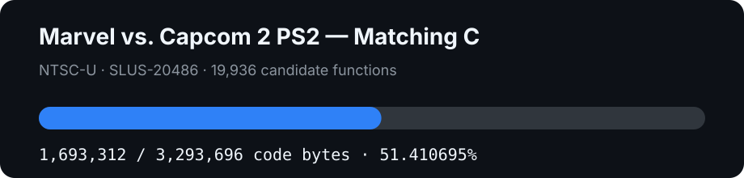

# Marvel vs. Capcom 2 — PS2 decompilation and native port

[](https://github.com/g-guthrie/mvc2-ps2-decomp/actions/workflows/report.yml)
[](https://decomp.dev/g-guthrie/mvc2-ps2-decomp)

[](DECOMP.md)

Two things live here:

1. **A matching decompilation** of *Marvel vs. Capcom 2: New Age of Heroes* for
   PlayStation 2 (NTSC-U `SLUS_204.86`): C source that compiles with the original
   toolchains to the retail executable, byte for byte.
2. **A native port** built from that source (`port/`): the game's own decompiled
   code running on modern hardware with no emulator, in the browser today, with
   desktop builds to follow. You bring your own copy of the game; no game data is
   included.

## Status

| Track | Progress |
| --- | --- |
| Decompiled code | **99.93%** (3,291,484 / 3,293,696 bytes; 20,181 / 20,678 functions) |
| Decompiled initialized data | **99.99%** (647,988 / 648,064 bytes) |
| Retail ELF rebuild | Byte-exact (SHA-256 `48ebf907…6f13d7`) |
| Port: web (WebAssembly + WebGL2, installable PWA) | Playable end to end |
| Port: Windows / macOS / Linux 64-bit | Planned |

What is left of the decomp, with the reason for each piece, is in
[REMAINING.md](REMAINING.md).

## The port

The port compiles the decompiled C for a 32-bit host (WebAssembly) and replaces
only the PS2 hardware layer: graphics (WebGL2), sound (ADX streams and sound
banks through Web Audio), controllers, memory card and disc access. Everything
the player does runs through the game's own code.

**What works**

- The whole game: arcade to the ending and staff roll (all Abyss forms), VS,
  Training, Score Attack, the Secret Factor shop and gallery, options,
  rankings, saves that survive a reload.
- Checked frame by frame against the retail PS2 executable running in an
  emulator: the attract cycle and scripted fights match for thousands of frames,
  including the PS2's float rounding.
- No load times, progressive output at native resolution with integer / smooth
  scaling and optional scanline or CRT filters.
- Full keyboard and gamepad remapping for two players, Xbox / PlayStation /
  Switch pads, a resizable touch overlay for phones, low input latency.
- Optional **arcade accuracy** settings, from a code comparison with the NAOMI
  arcade version ([ARCADE_DIFF.md](port/docs/ARCADE_DIFF.md)): arcade timing
  and input pipeline, super-freeze order, sine/cosine, float rounding,
  flying-screen edge and Servbot hit-stop behaviour. The arcade game was also run
  alongside the port to check them.
- Optional "unlock everything".

**Playing it**

The web build asks for your own disc image (`SLUS-20486`), caches it in the
browser, and runs offline afterwards. See the
[player guide](port/docs/USER_GUIDE.md) for controls, settings and building it
yourself, and [PORT_PLAN.md](port/docs/PORT_PLAN.md) for the roadmap.

**Port documentation**

| Document | Contents |
| --- | --- |
| [USER_GUIDE.md](port/docs/USER_GUIDE.md) | Controls, settings, building, test options |
| [PORT_PLAN.md](port/docs/PORT_PLAN.md) | Phases and roadmap |
| [BOOT_NOTES.md](port/docs/BOOT_NOTES.md) | How the port runs the game's code; every fix with its evidence |
| [ARCADE_DIFF.md](port/docs/ARCADE_DIFF.md) | PS2 vs NAOMI arcade: data and code comparison, arcade options |
| [PS2_GRIPES.md](port/docs/PS2_GRIPES.md) | Community complaints about the PS2 version and what the port does about each |
| [RENDERER.md](port/docs/RENDERER.md), [AUDIO.md](port/docs/AUDIO.md) | Graphics and sound layers |

## The decompilation

Every matched function is C compiled with a period toolchain (Metrowerks
MWCC 2.4/3.0/3.0.3, SN GCC 2.95.2, EE GCC 2.96, or Sony EE GCC 2.9) and
checked byte for byte against retail. The few routines that were hand-written
assembly in the original (crt0, the exception handler, libvu0 kernels, the
cache flush, newlib's r5900 string routines) are `.S` sources assembled with
GNU as 2.10-ee. The hybrid build links all of it with the remaining assembly
and reproduces the retail ELF exactly. CI checks the catalog, the build script
and the tools, but cannot compile, because the compilers are not
redistributable. See [DECOMP.md](DECOMP.md) for the workflow.

This is a separate project from the Dreamcast and NAOMI decompilations. The PS2
version runs on the Emotion Engine's MIPS R5900 and was built with
`MW MIPS C Compiler (2.4.1.01)` / `PlayStation2`.

## Target

| Item | Value |
| --- | --- |
| Serial | `SLUS-20486` |
| ELF entry point | `0x00100008` |
| ELF SHA-1 | `dd8558a04891b0b1472ea1d8ae2bb84947ae8937` |
| ELF SHA-256 | `48ebf907d8149122ca9bd622ed11c290d5f93173078ea5bd570e1ac5566f13d7` |
| Loaded image | `0x00100000..0x004c2580` (`3,941,760` bytes) |
| Loaded-image SHA-1 | `a425c36425bbc1072114ea091ac4577c98c59a6a` |
| Conservative text | `0x00100000..0x00424200` (`3,293,696` bytes) |
| Initialized data | `0x00424200..0x004c2580` (`648,064` bytes) |
| BSS | `0x004c2580..0x00634380` (`0x171e00` bytes) |
| Global pointer | `0x004c7270` |

The generated graphic above shows the current catalog's matching code coverage.
[decomp.dev](https://decomp.dev/g-guthrie/mvc2-ps2-decomp) publishes current
function counts and reconstructed-data coverage. Whole-object compiler
verification and full-image linkage are separate private build checks.
Assembly placeholders never count as decompiled source. The current inventory
contains **20,474 cataloged text spans** after boundary corrections and splitting
oversized dispatcher entries. Retained assembly residuals, text gaps and
initialized data remain separately visible in the progress report.

Compiler-in-the-loop evidence currently identifies
`mwcps2-3.0.3-020716` as the strongest product-build candidate with an `-O3`
baseline. See [docs/COMPILER.md](docs/COMPILER.md); the exact getter matches do
not yet discriminate `-O3` from `-O4,p` or prove the retail small-data threshold.

## Setup

Use your own legally obtained NTSC-U PS2 disc dump. For a single-track
`MODE2/2352` BIN/CUE pair:

```sh
python3 -m venv .venv
.venv/bin/pip install -r requirements.txt
make setup BIN="/path/to/game.bin" CUE="/path/to/game.cue"
make split
```

`bchunk` and `7z` must be installed for `make setup`. All extracted game data,
generated assembly, and build output remain ignored.

## Cloud executors

Supply your own build-inputs bundle using the layout in
[build-inputs/README.md](build-inputs/README.md).
See [docs/CLOUD_BUILD.md](docs/CLOUD_BUILD.md) for Linux dependencies.
After creating `.venv` and installing `requirements.txt`, prepare the Mac EE GCC
runner or Linux dependencies described in [docs/CLOUD_BUILD.md](docs/CLOUD_BUILD.md):

```sh
.venv/bin/python tools/bootstrap_private_inputs.py --archive /path/to/mvc2-ps2-build-inputs.tar.gz
. private/build.env
"$PYTHON" tools/setup_sony29.py
. private/sony29.env
make split hybrid test report PYTHON="$PYTHON"
```

The bootstrap verifies the supplied retail image, both Metrowerks compilers, SN GCC 2.95.2, and EE GCC 2.96,
selects a host-compatible Wibo, smoke-tests compilation, and supplies the tool
paths. No private repository access or GitHub authentication is required.

## Exact hybrid relink baseline

The stripped retail image mixes instructions and initialized data inside one
RWX segment. Until every code/data boundary is represented semantically, the
baseline rawifies Splat's reviewed per-word payload comments before assembling.
This prevents GNU assembler pseudo-op expansion from changing retail bytes.

```sh
make split
make relink
```

`make relink` reconstructs all 3,941,760 loaded bytes, links BSS at
`0x004c2580`, and requires both SHA-1 and SHA-256 plus a byte-for-byte `cmp`.
`make hybrid` also deterministically reconstructs the full retail ELF
container—headers, program headers, section headers, `.comment`, `.reginfo`,
and padding—and requires it to match `SLUS_204.86` byte-for-byte.

## Matching-C verification

After placing private `wibo` and `mwcps2.exe` binaries outside Git:

```sh
WIBO=/private/path/wibo-macos \
MWCCPS2=/private/path/mwccps2.exe \
MWCCPS2_30=/private/path/mwcps2-3.0-011126/mwccps2.exe \
make match PYTHON=.venv/bin/python
```

The verifier applies MIPS HI16/LO16/26/32 relocations using the reviewed target
symbols before comparing every function directly with the retail loaded image.
Most units use MWCCPS2 3.0.3; the explicitly documented `state_return_family`
unit is compiled with 3.0-011126 because that compiler is the only tested one
that reproduces its target scheduling exactly.

`make match` runs `tools/run_matching.py`, which reads
`tools/compile_matching.sh` and runs its independent units in parallel (one
worker per CPU; set `MATCH_JOBS` to change it) with verification in-process.
Compiled objects are cached under `build/cache/` by the content of everything
each command reads, so a rebuild recompiles only what changed; verification
always reruns. `--no-cache` forces a cold build, and `make match-serial` runs
the script top to bottom with `sh` as before. Every unit runs even after a
failure, and all failures are listed at the end. A cold `make hybrid` takes
about 3.5 minutes on 4 cores and an unchanged rebuild about one minute,
against roughly 16 minutes serially.

`make hybrid` then replaces all matched retail windows with the actual compiled
Metrowerks function sections and requires exact symbol placement plus the full
loaded-image hashes and byte comparison.

## Progress reporting

```sh
make test
make report
```

The GitHub Actions workflow uploads a valid objdiff-v2 report as `ps2_report`,
which is the artifact consumed by decomp.dev.

## Runtime testing

The rebuilt ELF is retail-exact, so it runs anywhere the retail game does. The
port (below) is tested frame by frame against the retail executable running in
an emulator (`port/tools/oracle`); emulator files are not part of this
repository.

## Legal

Executable and period compiler build inputs must be supplied locally. Disc
images, extracted game assets, generated retail assembly, and Sony SDK files
are excluded from the repository. The port contains no game data: it reads
the player's own disc image at run time (and, for the optional arcade data
study, the player's own NAOMI set). This research project is not affiliated
with Capcom, Marvel, Sony, Sega, or their licensors.

Older progress notes are kept in [docs/HISTORY.md](docs/HISTORY.md).
